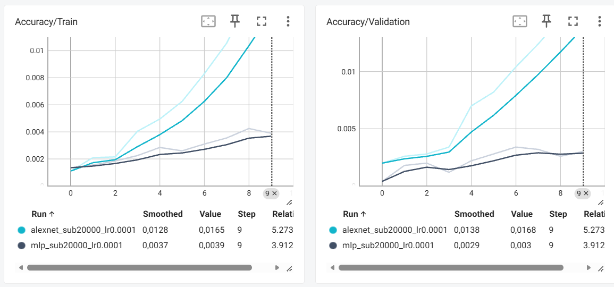
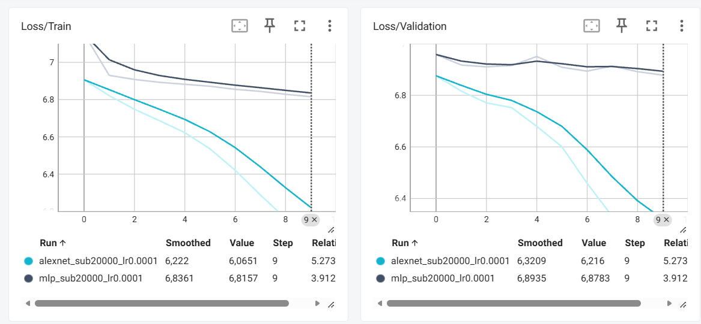
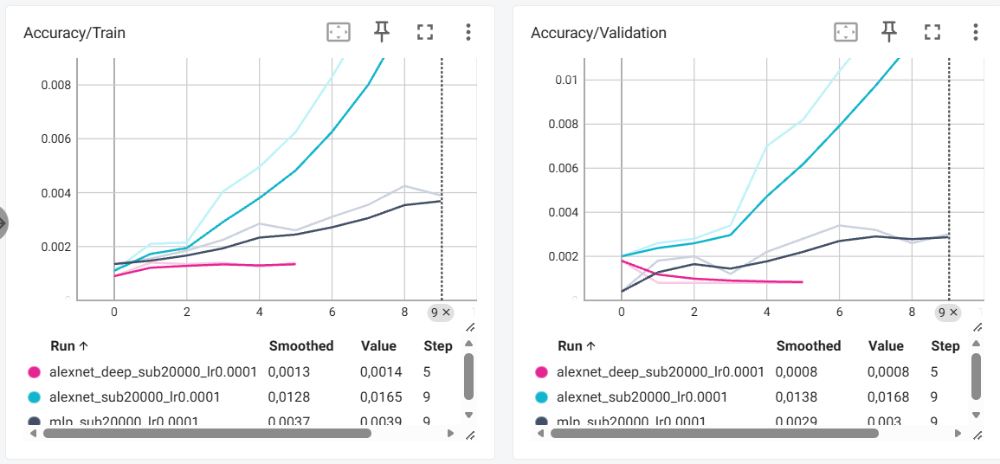
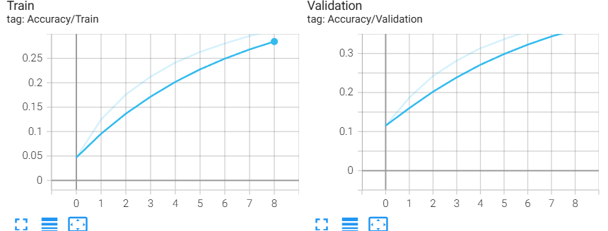
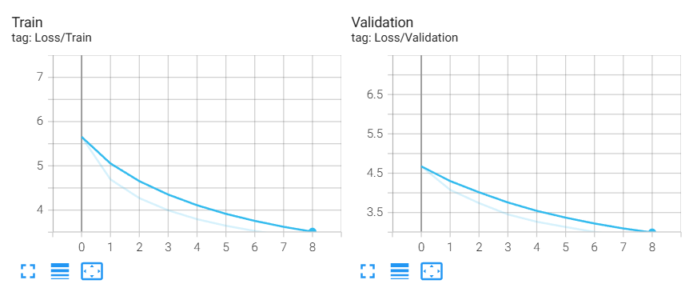

# CSC8607 - Introduction au Deep Learning

## TP3 - Réseaux convolutifs (CNN)

# Exercice 1 - Préparation d'ImageNet et augmentation de données

## 1.1 Prétraitement des images

Le dataset utilisé est ImageNet (ILSVRC 2012), qui contient 1000 classes.

Les images sont transformées en tenseurs de dimensions
(3, 227, 227) et normalisées avec les statistiques d'ImageNet.

Pour l'entraînement :
- RandomResizedCrop(227)
- RandomHorizontalFlip()
- ToTensor()
- Normalize()

Pour la validation :
- Resize(256)
- CenterCrop(227)
- ToTensor()
- Normalize()

Les transformations aléatoires sont utilisées pendant
l'entraînement pour améliorer la généralisation du modèle.

La validation utilise des transformations déterministes
pour obtenir des résultats comparables entre les époques.

## 1.2 Chargement des données

Le dataset ImageNet est chargé avec `torchvision.datasets.ImageNet`.

La fonction `get_dataloaders()` permet de créer deux DataLoaders :
- Train : données mélangées (`shuffle=True`).
- Validation : données non mélangées (`shuffle=False`).

Le chargement utilise 8 workers pour paralléliser la lecture des images.

Pour les tests rapides, un sous-ensemble peut être sélectionné
avec `subset_size`, en utilisant une graine fixe (`seed=42`)
pour assurer la reproductibilité des expériences.

## 1.3 Questions théoriques

### Question 1 - Importance de la normalisation

Sans normalisation, les valeurs des pixels ne sont pas centrées et peuvent avoir des distributions différentes selon les canaux. Cela peut produire des gradients mal équilibrés, ralentir la convergence et rendre l'entraînement moins stable.

La normalisation permet de centrer et de réduire les données selon la formule :

\[
x' = \frac{x-\mu}{\sigma}
\]

Les statistiques doivent être calculées uniquement sur les données d'entraînement afin d'éviter toute fuite d'information provenant des données de validation ou de test.

### Question 2 - Augmentation de données et validation

Pendant l'entraînement, `RandomResizedCrop` et `RandomHorizontalFlip` introduisent des variations aléatoires des images. Cela permet d'améliorer la généralisation du modèle et de limiter le surapprentissage.

Pour la validation, `Resize` et `CenterCrop` produisent des images de manière déterministe, afin d'évaluer les performances du modèle dans des conditions identiques à chaque époque.

### Question 3 - Cas où RandomHorizontalFlip est néfaste

Un exemple est la classification des chiffres manuscrits. Un retournement horizontal peut modifier la forme d'un chiffre et rendre son étiquette incorrecte.

Dans ce cas, cette augmentation peut introduire des données incohérentes et dégrader les performances du modèle.

# Exercice 2 Étude théorique et implémentation des architectures (MLP vs AlexNet)


## 2.1 - Implémentation du MLP

### Question 1 - Calcul du nombre de paramètres

Pour une couche `Linear`, le nombre de paramètres avec biais est :

$$
N = (n_{\text{entrée}} \times n_{\text{sortie}}) + n_{\text{sortie}}
$$

Sans biais :

$$
N = n_{\text{entrée}} \times n_{\text{sortie}}
$$

Le MLP contient trois couches entièrement connectées :

| Couche | Avec biais | Sans biais |
|---|---:|---:|
| Linear1 (154 587 -> 256) | 39 574 528 | 39 574 272 |
| Linear2 (256 -> 256) | 65 792 | 65 536 |
| Linear3 (256 -> 1 000) | 257 000 | 256 000 |
| **Total** | **39 897 320** | **39 896 808** |

Le nombre total de paramètres calculé théoriquement est **39 897 320**, ce qui correspond au résultat obtenu avec PyTorch.

La première couche représente environ **99,2 % des paramètres** du modèle.

### Vérification expérimentale

Résultats obtenus après exécution de `train_imagenet.py` :

```text
Nombre de paramètres : 39,897,320
Input shape : torch.Size([2, 3, 227, 227])
Output shape : torch.Size([2, 1000])
```

Le modèle reçoit un batch de 2 images RGB de taille 227 × 227 et produit 1 000 scores par image, correspondant aux classes d'ImageNet.

### Question 2 - Défaut structurel du MLP

Le principal défaut du MLP est qu'il traite l'image comme un vecteur de pixels, sans exploiter explicitement les relations spatiales entre pixels voisins.

Contrairement aux CNN, il ne possède pas de mécanisme de convolution permettant de détecter efficacement des motifs locaux (contours, textures, formes) à différentes positions de l'image.

Cela rend le modèle moins adapté à la classification d'images et nécessite un grand nombre de paramètres.

# 2.2 - Analyse et implémentation d'AlexNet


### Question 1 - Dimensions, paramètres et mémoire des activations

Pour une couche convolutive, la dimension spatiale de sortie est calculée par :

$$
H_{out} = \left\lfloor \frac{H_{in}+2P-K}{S}\right\rfloor+1
$$

Le nombre de paramètres d'une convolution avec biais est :

$$
N = C_{out}(C_{in}\times K^2+1)
$$

Pour une couche Linear :

$$
N = n_{out}(n_{in}+1)
$$

La mémoire des activations pour une image en FP32 est :

$$
M(KB) = \frac{C \times H \times W \times 4}{1024}
$$

Le tableau suivant présente les résultats pour une image d'entrée de taille (3, 227, 227).

| Couche | Entrée (C, H×W) | Hyperparamètres | Sortie (C, H×W) | Paramètres | Mémoire (KB) |
|---|---|---|---|---:|---:|
| Conv1 + ReLU | 3, 227×227 | 64, K=11, S=4, P=2 | 64, 56×56 | 23 296 | 784 |
| MaxPool1 | 64, 56×56 | K=3, S=2, P=0 | 64, 27×27 | 0 | 182,25 |
| Conv2 + ReLU | 64, 27×27 | 192, K=5, S=1, P=2 | 192, 27×27 | 307 392 | 546,75 |
| MaxPool2 | 192, 27×27 | K=3, S=2, P=0 | 192, 13×13 | 0 | 126,75 |
| Conv3 + ReLU | 192, 13×13 | 384, K=3, S=1, P=1 | 384, 13×13 | 663 936 | 253,50 |
| Conv4 + ReLU | 384, 13×13 | 256, K=3, S=1, P=1 | 256, 13×13 | 884 992 | 169 |
| Conv5 + ReLU | 256, 13×13 | 256, K=3, S=1, P=1 | 256, 13×13 | 590 080 | 169 |
| MaxPool3 | 256, 13×13 | K=3, S=2, P=0 | 256, 6×6 | 0 | 36 |
| Flatten + Dropout | 256, 6×6 | p=0.5 | 9216 (1D) | 0 | 36 |
| Linear1 + ReLU + Dropout | 9216 | 4096, p=0.5 | 4096 | 37 752 832 | 16 |
| Linear2 + ReLU | 4096 | 4096 neurones | 4096 | 16 781 312 | 16 |
| Linear3 (Sortie) | 4096 | 1000 classes | 1000 | 4 097 000 | 3,91 |
| **Total** | | | | **61 100 840** | **≈ 2 339,16** |

La mémoire totale des activations est d'environ **2340 KB par image**, en additionnant les sorties de chaque ligne du tableau. Il s'agit d'une estimation théorique : Flatten partage normalement le stockage de MaxPool3, et la mémoire réellement utilisée pendant l'entraînement dépend également des opérations conservées pour la rétropropagation.

### Vérification avec PyTorch

La fonction `count_parameters()` permet de vérifier le nombre de paramètres de chaque modèle.

Résultats obtenus :

```text
MLP parameters: 39,897,320
AlexNet parameters: 61,100,840
Input shape: torch.Size([1, 3, 227, 227])
Features shape: torch.Size([1, 256, 6, 6])
Output shape: torch.Size([1, 1000])
```

Les résultats expérimentaux correspondent aux calculs théoriques.

### Question 2 - Répartition des paramètres et des activations

Dans AlexNet, l'essentiel des paramètres se concentre dans les couches entièrement connectées (Linear), particulièrement Linear1 et Linear2.

En revanche, la mémoire des activations est principalement consommée par les premières couches convolutives, car leurs feature maps possèdent de grandes dimensions spatiales.

Ainsi, les couches Linear concentrent les poids, tandis que les premières convolutions concentrent les activations.

### Question 3 - Comparaison de la mémoire des activations avec le MLP

Pour le MLP, les activations de sortie des trois couches Linear occupent :

$$
M_{MLP} = \frac{(256+256+1000)\times4}{1024}
\approx 5,91\ KB
$$

Pour AlexNet, la somme des activations du tableau est d'environ **2340 KB**.

AlexNet nécessite donc beaucoup plus de mémoire pour ses activations, malgré un nombre de paramètres du même ordre de grandeur que le MLP.

Cela s'explique par le fait que les convolutions produisent des feature maps multidimensionnelles contenant de nombreuses valeurs spatiales, tandis que le MLP transforme directement l'image en un vecteur puis utilise des couches cachées de seulement 256 neurones.

Cette comparaison porte sur les sorties intermédiaires, sans compter l'image d'entrée ni l'ensemble de la mémoire réellement utilisée par la rétropropagation.


# Exercice 3 - Boucle d'entraînement, Early Stopping et Comparaison rapide
## 3.1 - Entraînement et comparaison du MLP et d'AlexNet

Les deux modèles ont été entraînés successivement sur un sous-ensemble d'ImageNet avec les paramètres suivants :

- Images d'entraînement : 20 000
- Images de validation : 5 000
- Batch size : 32
- Nombre d'époques : 10
- Optimiseur : Adam
- Learning rate : 0.0001 (1e-4)
- Weight decay : 0.00001 (1e-5)
- Early Stopping : patience de 5 époques

Les deux modèles ont terminé les 10 époques sans déclenchement de l'Early Stopping.

### Question 1 - Rôle de model.train() et model.eval()

`model.train()` active le mode entraînement. Dans AlexNet, les couches Dropout désactivent aléatoirement des neurones avec une probabilité de 0.5 afin de limiter le surapprentissage.

`model.eval()` place le modèle en mode évaluation et désactive le Dropout. Les neurones ne sont donc plus désactivés aléatoirement pendant la validation.

Sans `model.eval()`, le Dropout resterait actif pendant la validation, ce qui introduirait de l'aléatoire dans les prédictions et rendrait les métriques moins stables et moins représentatives des performances réelles du modèle en inférence.

### Question 2 - Accuracy et CrossEntropyLoss théoriques

ImageNet contient 1000 classes.

L'accuracy théorique d'un classifieur qui choisit uniformément une classe au hasard est :

$$
Accuracy = \frac{1}{1000} = 0.001 = 0.1\%
$$

La CrossEntropyLoss théorique pour des probabilités uniformes est :

$$
Loss = \ln(1000) \approx 6.9078
$$

Résultats de la première époque :

| Modèle | Train Loss | Train Accuracy | Val Loss | Val Accuracy |
|---|---:|---:|---:|---:|
| MLP | 7.1537 | 0.14 % | 6.9581 | 0.04 % |
| AlexNet | 6.9065 | 0.11 % | 6.8758 | 0.20 % |

Les résultats de la première époque sont globalement cohérents avec les valeurs théoriques d'une classification aléatoire.

Le MLP commence avec une loss plus élevée, tandis qu'AlexNet présente déjà une légère amélioration de la validation loss.

### Question 3 - Comparaison des performances

Résultats des entraînements :

| Métrique | MLP | AlexNet |
|---|---:|---:|
| Époques effectuées | 10 | 10 |
| Train Loss initiale | 7.1537 | 6.9065 |
| Train Loss finale | 6.8157 | 6.0651 |
| Validation Loss initiale | 6.9581 | 6.8758 |
| Meilleure Validation Loss | 6.8783 | 6.2160 |
| Train Accuracy finale | 0.39 % | 1.65 % |
| Validation Accuracy finale | 0.30 % | 1.68 % |
| Meilleure Validation Accuracy | 0.34 % | 1.68 % |
| Early Stopping | Non déclenché | Non déclenché |

**Apprentissage :**

AlexNet apprend nettement mieux que le MLP.

Sa validation loss diminue progressivement de 6.8758 à 6.2160 et son accuracy de validation augmente de 0.20 % à 1.68 %.

Le MLP progresse également, mais plus lentement. Sa validation loss reste proche de 6.9 et son accuracy finale atteint seulement 0.30 %.

Cette différence s'explique par les couches convolutives d'AlexNet, qui exploitent les relations spatiales entre les pixels, contrairement au MLP qui traite les images comme des vecteurs.

**Surapprentissage (Overfitting) :**

Le MLP présente quelques fluctuations de la validation loss malgré une diminution continue de la train loss. Il montre donc de légers signes de surapprentissage.

Pour AlexNet, les pertes d'entraînement et de validation diminuent toutes les deux pendant les 10 époques. La validation loss reste légèrement supérieure à la train loss en fin d'entraînement, mais il n'y a pas de signe marqué de surapprentissage.

Ainsi, sur ces 10 époques, le MLP présente plus tôt des signes de difficulté à généraliser, tandis qu'AlexNet continue à améliorer ses performances en validation.

**Conclusion :**

AlexNet est plus adapté à la classification d'images grâce aux convolutions qui permettent d'extraire des caractéristiques spatiales.

Même si son accuracy reste faible en valeur absolue, elle dépasse largement la référence aléatoire de 0.1 %, contrairement au MLP dont les performances restent beaucoup plus proches de cette référence.

### Courbes TensorBoard

Les courbes suivantes présentent les évolutions des losses et accuracies d'entraînement et de validation pour les deux modèles.



## 3.2 - Impact de la profondeur

Nous avons ajouté trois couches convolutives supplémentaires
à AlexNet, après Conv5 et avant MaxPool3.

Chaque couche ajoutée possède 256 filtres de taille 3 × 3,
un padding de 1 et une activation ReLU.

Le nombre de paramètres passe de **61 100 840** pour AlexNet
standard à **62 871 080** pour AlexNetDeep.

Les deux architectures ont été testées avec les mêmes
hyperparamètres : Adam (lr=1e-4, weight_decay=1e-5),
batch size 32 et 20 000 images d'entraînement.

| Métrique | AlexNet | AlexNetDeep |
|---|---:|---:|
| Couches convolutives | 5 | 8 |
| Paramètres | 61 100 840 | 62 871 080 |
| Époques réalisées | 10 | 6 |
| Train Loss finale | 6.0651 | 6.8912 |
| Meilleure Val Loss | 6.2160 | 6.9077 |
| Train Accuracy finale | 1.65 % | 0.14 % |
| Meilleure Val Accuracy | 1.68 % | 0.18 % |
| Early Stopping | Non | Époque 6 |

### Question - Impact de la profondeur et propagation du gradient

L'ajout de trois couches convolutives dégrade fortement
l'apprentissage du modèle.

AlexNet standard atteint une accuracy de validation de 1.68 %,
tandis qu'AlexNetDeep reste proche du hasard (0.1 %).
Sa validation loss reste autour de 6.9078, et l'entraînement
s'arrête après 6 époques.

Il s'agit principalement d'un problème de **sous-apprentissage
(underfitting)** et de difficulté d'optimisation, plutôt que
de surapprentissage (overfitting).

En effet, la perte d'entraînement reste elle-même élevée.
Dans un cas de surapprentissage, on observerait plutôt
une forte diminution de la train loss, accompagnée
d'une stagnation ou d'une augmentation de la validation loss.

L'ajout de couches augmente le nombre d'opérations traversées
par le gradient pendant la rétropropagation.

Le gradient est calculé par la règle de la chaîne, qui implique
la multiplication successive de dérivées. Dans un réseau plus
profond, ces multiplications peuvent provoquer une atténuation
des gradients (vanishing gradient), compliquant la mise à jour
des premières couches.

Sans mécanismes facilitant la propagation du gradient,
comme les connexions résiduelles utilisées dans ResNet,
un réseau plus profond peut donc être plus difficile à optimiser,
même s'il possède théoriquement une capacité de représentation
supérieure.

Nos résultats sont compatibles avec cette difficulté
d'optimisation, sans démontrer directement un phénomène
de vanishing gradient, puisque les normes des gradients
n'ont pas été mesurées.

### Courbes TensorBoard




# Exercice 4 - Lancement et analyse d'un entraînement long avec Slurm

## 4.1 - Configuration de l'entraînement

Un entraînement d'AlexNet a été lancé sur l'intégralité du dataset ImageNet (environ 1,28 million d'images d'entraînement), à l'aide d'un job Slurm exécuté en arrière-plan.

**Configuration matérielle :**

- GPU : NVIDIA L4 (23 Go de VRAM)
- CPU : 8
- RAM : 24 Go
- Partition : gpu
- Durée maximale du job : 4 heures
- Job ID : 9006

**Configuration du modèle :**

- Modèle : AlexNet (61 100 840 paramètres)
- Batch size : 256
- Optimiseur : Adam
- Learning rate : 1e-4
- Weight decay : 1e-5
- Nombre maximal d'époques : 50
- Early Stopping : patience de 5 époques
- Dataset : ImageNet complet (`subset_size=None`)

L'entraînement a réalisé **9 époques complètes** avant d'être interrompu pendant la 10e époque par la limite de temps Slurm.

## 4.2 - Question 1 : Profilage temporel et matériel

Chaque époque comporte 5005 batches pour traiter environ 1,28 million d'images.

D'après les logs, les durées des époques complètes sont :

| Époque | Durée (secondes) |
|---|---:|
| 1 | 1524.36 |
| 2 | 1520.82 |
| 3 | 1524.84 |
| 4 | 1521.27 |
| 5 | 1523.72 |
| 6 | 1526.18 |
| 7 | 1521.08 |
| 8 | 1528.85 |
| 9 | 1524.97 |

La durée d'une époque est d'environ **1524 secondes, soit 25 minutes et 24 secondes**, validation comprise.

À cette vitesse, le temps nécessaire pour effectuer 100 époques sans Early Stopping est estimé à :

$$
T_{100} = \frac{1524 \times 100}{3600}
\approx 42.33\ heures
$$

Il faudrait donc environ **42 heures et 20 minutes** pour terminer 100 époques, sans compter les temps d'attente entre les jobs Slurm.

## 4.3 - Question 2 : Analyse de l'entraînement

### Résultats expérimentaux

Les résultats obtenus après 9 époques sont :

| Époque | Train Loss | Val Loss | Train Accuracy | Val Accuracy |
|---|---:|---:|---:|---:|
| 1 | 5.6542 | 4.6734 | 4.70 % | 11.52 % |
| 2 | 4.6927 | 4.0765 | 12.48 % | 18.71 % |
| 3 | 4.2699 | 3.7399 | 17.61 % | 24.23 % |
| 4 | 3.9945 | 3.4523 | 21.24 % | 28.18 % |
| 5 | 3.7937 | 3.2651 | 24.13 % | 31.33 % |
| 6 | 3.6461 | 3.1322 | 26.30 % | 33.63 % |
| 7 | 3.5274 | 3.0068 | 28.05 % | 35.72 % |
| 8 | 3.4273 | 2.9120 | 29.57 % | 37.41 % |
| 9 | 3.3455 | 2.8385 | 30.85 % | 38.61 % |

La loss d'entraînement diminue progressivement de 5.6542 à 3.3455, tandis que la validation loss passe de 4.6734 à 2.8385.

L'accuracy de validation augmente de 11.52 % à **38.61 %**, ce qui montre que le modèle apprend efficacement sur le dataset complet.

### Comparaison avec l'exercice 3

Dans l'exercice 3, AlexNet avait été entraîné sur un sous-ensemble de 20 000 images pendant 10 époques. Il avait atteint une validation loss de 6.2160 et une accuracy de validation de 1.68 %.

Sur ImageNet complet, après 9 époques, la validation loss atteint 2.8385 et l'accuracy de validation 38.61 %.

| Métrique | Sous-ensemble (20k) | ImageNet complet |
|---|---:|---:|
| Époques réalisées | 10 | 9 |
| Train Loss finale | 6.0651 | 3.3455 |
| Val Loss finale | 6.2160 | 2.8385 |
| Train Accuracy finale | 1.65 % | 30.85 % |
| Val Accuracy finale | 1.68 % | 38.61 % |

Sur le petit sous-ensemble, la validation loss était légèrement supérieure à la train loss en fin d'entraînement, indiquant un écart de généralisation.

Sur ImageNet complet, la validation loss reste inférieure à la train loss pendant les 9 époques observées.

Le surapprentissage est donc beaucoup moins apparent sur le dataset complet.

Cela s'explique principalement par le nombre beaucoup plus important d'images et leur diversité. Le modèle dispose de davantage d'exemples pour apprendre les caractéristiques de chaque classe, ce qui limite la mémorisation des données d'entraînement.

La Data Augmentation contribue également à améliorer la généralisation en introduisant des variations dans les images pendant l'entraînement.


Les courbes observées ne montrent pas de surapprentissage marqué sur les 9 premières époques du dataset complet.

### Courbes TensorBoard

Les courbes suivantes présentent les évolutions des pertes et des accuracies d'entraînement et de validation.





## 4.4 - Question 3 : Pourquoi la validation loss est-elle inférieure à la train loss ?

Pendant les premières époques, la validation loss est inférieure à la train loss.

Deux raisons techniques liées au code expliquent principalement ce phénomène.

**1. Dropout**

Pendant l'entraînement, `model.train()` active les couches `nn.Dropout(p=0.5)` d'AlexNet.

Certains neurones sont désactivés aléatoirement, ce qui rend l'apprentissage plus difficile et peut augmenter la train loss.

Pendant la validation, `model.eval()` désactive le Dropout, permettant d'utiliser tous les neurones et d'obtenir des prédictions plus stables.

**2. Data Augmentation**

Pendant l'entraînement, `RandomResizedCrop` et `RandomHorizontalFlip` appliquent des transformations aléatoires aux images.

Ces transformations rendent les exemples d'entraînement plus variés et parfois plus difficiles à classifier.

En validation, les transformations `Resize` et `CenterCrop` sont déterministes, ce qui facilite une évaluation stable du modèle.

Enfin, la train loss est calculée pendant la mise à jour progressive des poids sur l'ensemble de l'époque, tandis que la validation utilise les poids obtenus à la fin de celle-ci.

Ces différences peuvent expliquer pourquoi la validation loss est inférieure à la train loss, sans que cela indique une erreur d'entraînement.

## 4.5 - Conclusion

L'entraînement sur ImageNet complet a permis d'améliorer nettement les performances d'AlexNet par rapport au sous-ensemble de 20 000 images.

Après 9 époques, le modèle atteint **38.61 % d'accuracy en validation**, contre 1.68 % dans l'exercice 3.

Les pertes diminuent régulièrement, sans signe marqué de surapprentissage durant les époques observées.

Le job Slurm a permis de réaliser cet entraînement long en arrière-plan, jusqu'à son interruption automatique après 4 heures.
