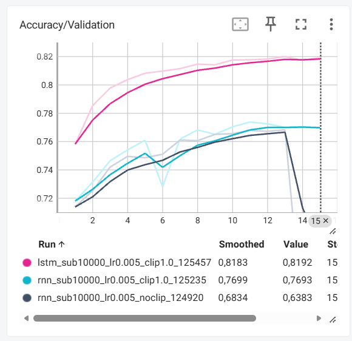
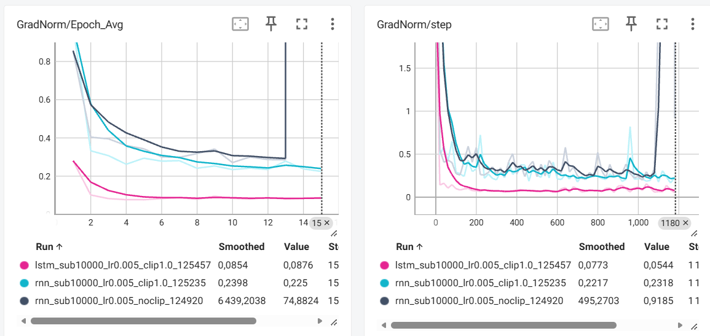
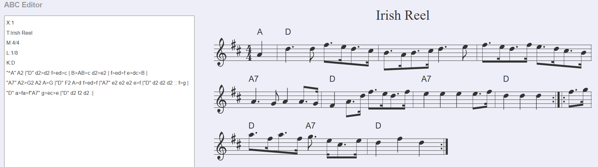
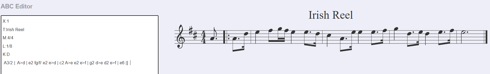
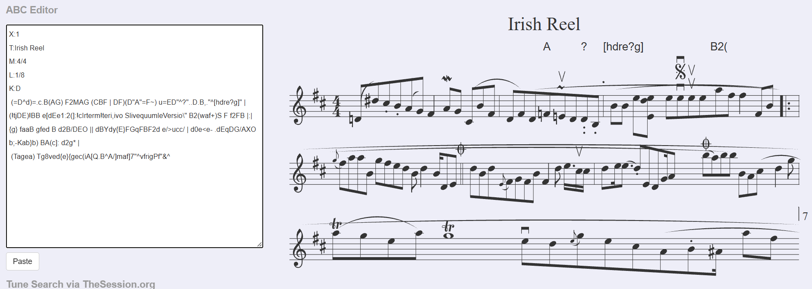
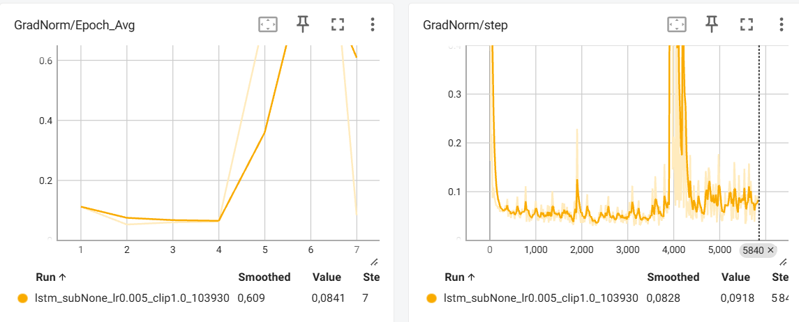
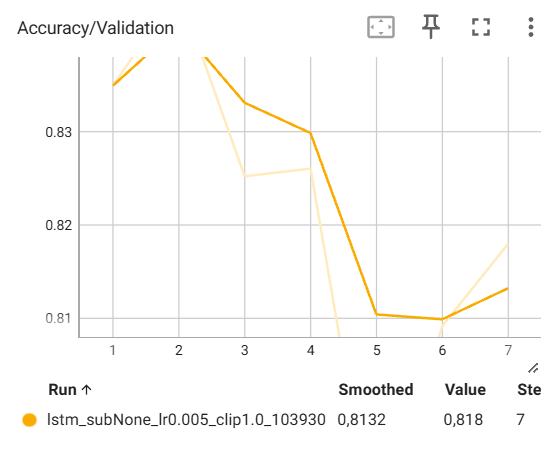

# CSC8607 — Introduction au Deep Learning
## TP4 — Réseaux récurrents et génération musicale

## Exercice 1 — Exploration et prétraitement

### Étape 1 — Chargement et découverte des données

#### Question 1 — Nombre de partitions

Le dataset contient :
- **214 122 partitions d'entraînement**.
- **2 162 partitions de validation**.

Les données sont chargées à partir des fichiers JSON avec `json.load()`.

#### Question 2 — Analyse de la première partition ABC

La première partition contient les métadonnées suivantes :

- **X:1** : identifiant de la partition.
- **L:1/8** : durée de note par défaut (croche).
- **M:4/4** : mesure à quatre temps.
- **K:Emin** : tonalité de Mi mineur.

La suite contient les notes musicales (A à G).
Les majuscules et minuscules indiquent des octaves différentes,
les chiffres représentent la durée des notes et les barres `|`
séparent les mesures.

Les symboles `|:` et `:|` indiquent les reprises, tandis que
`^` indique une altération (dièse).

La notation ABC permet de représenter une partition musicale
sous une forme textuelle compacte.


### Étape 2 — Construction du vocabulaire et Padding

#### Question 1 — Statistiques du dataset

Le dataset contient :
- **95 caractères uniques** dans le vocabulaire.
- **290,1 caractères** en moyenne par partition.
- **2 968 caractères** pour la partition la plus longue.

Le vocabulaire est construit à partir des caractères uniques
présents dans les partitions d'entraînement et de validation.

#### Question 2 — Pourquoi utiliser sorted() ?

La fonction `sorted()` garantit un ordre fixe des caractères
dans le vocabulaire.

Sans ce tri, les indices associés aux caractères pourraient
changer entre deux exécutions, ce qui poserait problème
lors du chargement d'un modèle sauvegardé.

#### Question 3 — Pourquoi choisir SEQ_LENGTH = 500 ?

Une longueur fixe de 500 caractères permet de limiter
le temps de calcul et la consommation de mémoire GPU.

Utiliser la longueur maximale de 2 968 caractères
entraînerait beaucoup de padding inutile, puisque
la longueur moyenne des partitions est de 290,1 caractères.

Le choix de 500 caractères constitue donc un compromis
entre la conservation des informations musicales
et l'efficacité de l'entraînement.


## Exercice 2 — Dataset PyTorch et Modélisation

### Étape 1 — Création du MusicDataset

#### Question 1 — Dimensions des tenseurs et type de données

Avec `SEQ_LENGTH = 500` et `BATCH_SIZE = 128`,
les dimensions obtenues sont :

- **Shape x :** `torch.Size([128, 499])`
- **Shape y :** `torch.Size([128, 499])`

Chaque séquence contient 499 caractères, car l'entrée
exclut le dernier caractère et la cible exclut le premier.

Le modèle apprend ainsi à prédire le caractère suivant
à chaque pas de temps.

Nous utilisons `torch.long` (int64) car les caractères
sont représentés par des indices entiers dans le
vocabulaire.

La couche `nn.Embedding` attend des indices entiers,
et non des nombres flottants (`torch.float32`).


### Étape 2 — Architecture récurrente (RNN vs LSTM)

#### Question 1 — Calcul du nombre de paramètres

Avec `vocab_size = 95`, `embedding_dim = 256`
et `hidden_size = 512` :

**Couche Embedding (identique pour RNN et LSTM) :**

95 × 256 = **24 320 paramètres**

**Couche RNN :**

- Poids entrée : 512 × 256 = 131 072
- Poids récurrents : 512 × 512 = 262 144
- Deux biais : 2 × 512 = 1 024

Total RNN : **394 240 paramètres**

**Couche LSTM :**

Le LSTM comporte quatre transformations
(porte d'entrée, porte d'oubli, porte de sortie
et état candidat).

4 × (131 072 + 262 144 + 1 024)

Total LSTM : **1 576 960 paramètres**

**Couche Linear (identique pour RNN et LSTM) :**

512 × 95 + 95 = **48 735 paramètres**

**Comparaison finale :**

| Couche | RNN | LSTM |
|---|---:|---:|
| Embedding | 24 320 | 24 320 |
| Récurrente | 394 240 | 1 576 960 |
| Linear | 48 735 | 48 735 |
| Total | 467 295 | 1 650 015 |

Le bloc récurrent LSTM possède exactement
quatre fois plus de paramètres que celui du RNN,
car il utilise quatre transformations distinctes,
chacune avec ses propres poids et ses deux biais.

#### Question 2 — Pourquoi utiliser nn.Embedding ?

La couche `nn.Embedding` associe à chaque caractère
un vecteur de caractéristiques appris pendant
l'entraînement.

Contrairement à un simple indice scalaire, elle
n'impose pas de relation numérique artificielle
entre les caractères.

Elle permet au modèle d'apprendre des représentations
plus adaptées aux relations entre les symboles musicaux.

#### Question 3 — Différence entre hidden_state du RNN et du LSTM

Dans un RNN classique, `hidden_state` contient
uniquement l'état caché `h_t`, qui représente
les informations mémorisées jusqu'au pas de temps courant.

Dans un LSTM, `hidden_state` contient deux états :

- `h_t` : l'état caché utilisé pour produire la sortie.
- `c_t` : l'état de cellule qui conserve les informations
  sur de plus longues séquences.

Grâce à ses portes, le LSTM contrôle les informations
à conserver, à oublier et à transmettre.

Cette architecture lui permet de mieux gérer
les dépendances à long terme et de limiter
le problème du vanishing gradient.


## Exercice 3 — Entraînement et dynamique des gradients

### Question 1 — Redimensionnement des tenseurs

Le modèle produit un tenseur de logits de dimensions
`(128, 499, 95)`.

Pour utiliser `CrossEntropyLoss`, nous devons le
transformer en `(63872, 95)` avec :

`logits.reshape(-1, vocab_size)`

De même, les cibles sont transformées de `(128, 499)`
à `(63872,)` avec :

`y.reshape(-1)`

La dimension `-1` correspond ici à :

128 × 499 = **63 872 caractères**.

Cela permet de calculer la perte de classification
sur tous les caractères du batch.

### Question 2 — Ordre du Gradient Clipping

La fonction `clip_grad_norm_` doit être appelée après
`loss.backward()`, car les gradients doivent d'abord
être calculés.

Elle doit être appelée avant `optimizer.step()` afin
de limiter les gradients trop élevés avant la mise
à jour des poids.

Le Gradient Clipping permet de réduire le risque
d'exploding gradients et de stabiliser l'entraînement,
notamment pour les RNN sur de longues séquences.


### Expérience 1 — RNN sans Gradient Clipping

**Configuration :**
- Modèle : RNN
- Dataset : 10 000 partitions
- Batch size : 128
- Learning rate : 0.005
- Époques : 15
- Gradient Clipping : désactivé

**Résultats :**

| Mesure | Résultat |
|---|---:|
| Meilleure Validation Loss | 0.7430 |
| Époque du meilleur modèle | 12 |
| Accuracy à l'époque 12 | 76.72 % |
| Validation Loss finale | 1.3967 |
| Accuracy finale | 63.83 % |
| Gradient Norm (époque 14) | 26692.159 |

**Observations :**

La Loss de validation diminue progressivement jusqu'à
l'époque 12, où elle atteint 0.7430.

À l'époque 14, on observe une explosion des gradients :
leur norme moyenne atteint 26692.159, contre 0.285
à l'époque précédente.

Cette instabilité entraîne une forte augmentation
de la Loss de validation (1.6031) et une diminution
de l'Accuracy (63.38 %).

Cette expérience illustre le problème des
*exploding gradients* dans les RNN classiques.

Le meilleur modèle est sauvegardé à l'époque 12,
avant cette dégradation.


### Expérience 2 — RNN avec Gradient Clipping

**Configuration :**
- Modèle : RNN
- Dataset : 10 000 partitions
- Batch size : 128
- Learning rate : 0.005
- Époques : 15
- Gradient Clipping : max_norm = 1.0

**Résultats :**

| Mesure | Résultat |
|---|---:|
| Meilleure Validation Loss | 0.7236 |
| Époque du meilleur modèle | 11 |
| Accuracy au meilleur modèle | 77.38 % |
| Validation Loss finale | 0.7322 |
| Accuracy finale | 76.93 % |
| Norme moyenne finale des gradients | 0.225 |

**Observations :**

Avec le Gradient Clipping, l'entraînement est globalement
plus stable.

La meilleure Loss de validation atteint 0.7236,
contre 0.7430 sans clipping.

L'Accuracy au meilleur checkpoint augmente également
de 76.72 % à 77.38 %.

Contrairement au Run 1, aucune explosion massive
des gradients n'est observée pendant les 15 époques.

Le clipping limite la norme des gradients à 1.0
avant la mise à jour des paramètres, ce qui aide
à stabiliser l'apprentissage.

### Comparaison — RNN sans et avec Gradient Clipping

| Indicateur | Sans clipping | Avec clipping |
|---|---:|---:|
| Meilleure Validation Loss | 0.7430 | 0.7236 |
| Accuracy au meilleur checkpoint | 76.72 % | 77.38 % |
| Validation Loss finale | 1.3967 | 0.7322 |
| Accuracy finale | 63.83 % | 76.93 % |

Le RNN sans clipping subit une explosion des gradients
à l'époque 14, avec une norme moyenne de 26692.159,
entraînant une forte dégradation des performances.

Le RNN avec clipping conserve des performances plus
stables jusqu'à la fin de l'entraînement.

Ces résultats montrent l'intérêt du Gradient Clipping
pour limiter les instabilités des réseaux récurrents.


### Expérience 3 — LSTM avec Gradient Clipping

**Configuration :**
- Modèle : LSTM
- Dataset : 10 000 partitions
- Batch size : 128
- Learning rate : 0.005
- Nombre d'époques : 15
- Gradient Clipping : max_norm = 1.0

**Résultats :**

| Mesure | Résultat |
|---|---:|
| Meilleure Validation Loss | 0.5563 |
| Époque du meilleur modèle | 13 |
| Accuracy au meilleur checkpoint | 82.00 % |
| Validation Loss finale | 0.5601 |
| Accuracy finale | 81.92 % |
| Norme moyenne finale des gradients | 0.088 |

**Observations :**

Le LSTM obtient les meilleures performances parmi les
trois expériences.

Sa Loss de validation diminue de 0.7786 à 0.5563
à l'époque 13, avec une Accuracy de 82.00 %.

L'entraînement reste globalement stable et aucune
explosion majeure des gradients n'est observée.

Les mécanismes de portes du LSTM lui permettent
de mieux gérer les dépendances à long terme,
ce qui peut expliquer ses meilleures performances
sur les séquences musicales.

### Comparaison finale des trois expériences

| Indicateur | RNN sans clipping | RNN avec clipping | LSTM avec clipping |
|---|---:|---:|---:|
| Meilleure Val Loss | 0.7430 | 0.7236 | 0.5563 |
| Accuracy au meilleur checkpoint | 76.72 % | 77.38 % | 82.00 % |
| Val Loss finale | 1.3967 | 0.7322 | 0.5601 |
| Accuracy finale | 63.83 % | 76.93 % | 81.92 % |

**Conclusion :**

Le RNN sans clipping subit une explosion des gradients
à l'époque 14, avec une norme moyenne de 26692.159,
ce qui dégrade fortement ses performances.

Le RNN avec clipping présente un entraînement
plus stable et de meilleures performances.

Le LSTM avec clipping obtient la plus faible Loss
de validation et la meilleure Accuracy.

Ces résultats montrent l'intérêt du Gradient Clipping
pour stabiliser l'entraînement et l'avantage potentiel
du LSTM pour modéliser des séquences musicales.


### Analyse expérimentale — TensorBoard


#### Accuracy de validation



#### Évolution de la norme des gradients




### Question 4 — Impact du padding sur l'Accuracy

Une partition de 250 caractères est complétée avec
250 espaces pour atteindre SEQ_LENGTH = 500.

Ces espaces sont faciles à prédire et sont comptabilisés
dans l'Accuracy, au même titre que les notes musicales.

L'Accuracy affichée peut donc être artificiellement
élevée sans refléter la véritable capacité du modèle
à prédire correctement les notes.

Pour éviter ce problème, on peut utiliser :

```python
loss_fn = nn.CrossEntropyLoss(
    ignore_index=char_to_index[" "]
)
```

Cela permet d'ignorer les espaces dans le calcul
de la Loss.

Cependant, comme les espaces existent aussi naturellement
dans la notation ABC, cette solution les ignore également.
Une solution plus précise serait d'utiliser un token
spécifique au padding et de n'ignorer que ce token.

Il faudrait aussi exclure le padding du calcul de
l'Accuracy pour obtenir une métrique plus représentative.


## Exercice 4 — Génération musicale

### Étape 1 — Génération auto-régressive

Nous utilisons le meilleur modèle LSTM entraîné
lors de l'exercice 3.

Ce modèle a obtenu :
- Validation Loss : 0.5563
- Validation Accuracy : 82.00 %
- Meilleure époque : 13

La génération est réalisée caractère par caractère
à partir d'une amorce musicale au format ABC.

#### Question 1 — Pourquoi conserver hidden_state ?

La conservation de `hidden_state` permet au LSTM
de mémoriser les informations de la séquence
précédemment générée.

Sans cette conservation, il faudrait retraiter
toute la séquence à chaque génération d'un
nouveau caractère, ce qui serait plus coûteux.

Avec la conservation de l'état caché, chaque
nouveau caractère nécessite un seul pas de calcul.

#### Question 2 — Influence de la température

La température modifie la distribution des
probabilités calculée par Softmax.

- T = 0.2 : génération plus déterministe,
  privilégiant les caractères les plus probables.

- T = 0.8 : compromis entre cohérence et diversité.

- T = 2.0 : génération plus aléatoire et diversifiée,
  avec davantage de risques d'incohérences.

Une température proche de zéro se rapproche
d'un choix glouton du caractère le plus probable.

Une température très élevée produit une
distribution de probabilités presque uniforme.

#### Question 3 — Influence de la température

Nous avons utilisé le meilleur modèle LSTM obtenu lors
de l'exercice 3 pour générer 300 caractères supplémentaires
à partir de l'amorce "Irish Reel".

Les températures testées sont 0.2, 0.8 et 2.0.

**T = 0.2 :**

La partition est relativement structurée. On observe
des notes ABC, des barres de mesure, des accords et des
motifs répétés. La génération reste assez prévisible.

Cependant, de nombreux espaces apparaissent à la fin,
ce qui révèle une influence du padding appris.

**T = 0.8 :**

La génération contient des motifs mélodiques et une
structure ABC relativement cohérente, mais le modèle
produit rapidement un symbole de fin de morceau `|]`.

La majorité des caractères restants sont des espaces.
La partition est donc courte malgré les 300 caractères
générés.

**T = 2.0 :**

La génération devient beaucoup plus aléatoire.

Elle contient des séquences de notes incohérentes,
des symboles inhabituels et des fragments de texte
qui ne correspondent pas à une partition musicale
correctement structurée.

La température élevée augmente la diversité au
détriment de la cohérence syntaxique.

**Conclusion :**

La température contrôle le compromis entre diversité
et cohérence musicale.

Dans nos expériences, T = 0.2 produit la partition
la plus structurée, tandis que T = 2.0 produit
une séquence largement incohérente.

Le modèle présente également une limitation liée
au padding, puisqu'il génère parfois de longues
séquences d'espaces après la fin du morceau.


### Partitions générées

#### Température 0.2

```abc
X:1
T:Irish Reel
M:4/4
L:1/8
K:D
"^A" A2 |"D" d2>d2 f>ed>c | B>AB>c d2>e2 | f>ed>f e>dc>B | 
"A7" A2>G2 A2 A>G |"D" F2 A>d f>ed>f |"A7" e2 e2 e2 e>f |"D" d2 d2 d2 :: f>g | 
"D" a>fa>f"A7" g>ec>e |"D" d2 f2 d2 :|                                                                                                                          
```



#### Température 0.8

```abc
X:1
T:Irish Reel
M:4/4
L:1/8
K:D
 A3/2 |: A>d | e2 fg/f/ e2 e>d | c2 A>e e2 e>f | g2 d>e d2 e>f | e6 |]                                                                                                                                                                                                                                      
```



#### Température 2.0

```abc
X:1
T:Irish Reel
M:4/4
L:1/8
K:D
 (=D^d)=.c.B(AG) F2MAG (CBF | DF)(D"A"=F~) u=ED"^?"..D.B,."^[hdre?g]" | (!tjDE)!BB e[dEe1:2(]:!cIrterm!teri,ivo SlivequumleVersio\" B2(waf+)S F f2FB |:|
{g} faaB gfed B d2B/DEO || dBYdy{E}FGqFBF2d e/>ucc/ | d0e<e- .dEqDG/AXO b;-Kab}b) BA(c]: d2g* | 
 (Tagea) Tg8ved{e}{gec(iA[Q.B^A/]maf]7"^vfrigPf"&^
```



### Étape 2 — Entraînement long avec Slurm

#### Configuration

- Modèle : LSTM
- Dataset : 214 122 partitions
- Hidden size : 1024
- Embedding dimension : 256
- Batch size : 256
- Learning rate : 0.005
- Gradient Clipping : 1.0
- Early Stopping : patience = 5

L'entraînement a été exécuté sur le cluster GPU avec Slurm (`sbatch`).

#### Résultats

- Époques effectuées : **7**
- Meilleure Validation Loss : **0.4760**
- Accuracy au meilleur checkpoint : **84.51 %**
- Meilleure époque : **2**


#### Visualisation TensorBoard








