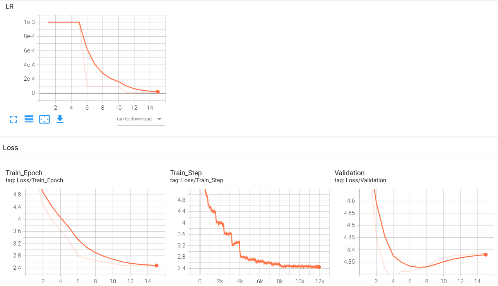

# TP5 - CSC8607 : Introduction au Deep Learning

## CI5 - Image Captioning avec RNN et Attention sur ResNet

## Exercice 1 - Chargement des données et Embeddings

### Question 1.a - Redimensionnement des images

Les images sont redimensionnées à une taille fixe de **224 × 224 pixels** pour garantir des dimensions homogènes dans les batches et respecter le format d'entrée utilisé lors du pré-entraînement de ResNet50 sur ImageNet.

## Exercice 2 - Extraction de caractéristiques et Transfer Learning

### Question 2.a - Gel des poids de ResNet50

Le gel des poids de ResNet50 (`requires_grad = False`) est important pour deux raisons :

- **Raison matérielle :** il réduit la consommation de mémoire GPU et le coût des calculs, car il n'est pas nécessaire de calculer ni de stocker les gradients des paramètres du CNN pendant l'entraînement.
- **Raison algorithmique :** il permet de conserver les caractéristiques visuelles déjà apprises sur ImageNet et d'éviter de les dégrader lors de l'entraînement sur Flickr30k. L'apprentissage peut ainsi se concentrer sur le module d'attention et le LSTM.

### Question 2.a - Dimensions de sortie de ResNet50

Pour un tenseur d'entrée de forme `(32, 3, 224, 224)`, la sortie de `cnn_features` aura la forme :

`(32, 2048, 7, 7)`

- `32` : nombre d'images dans le batch.
- `2048` : nombre de canaux de caractéristiques extraits par ResNet50.
- `7 × 7` : dimensions spatiales de la carte de caractéristiques, correspondant à 49 régions utilisées par le mécanisme d'attention.

La suppression des deux dernières couches (`AdaptiveAvgPool2d` et `Linear`) permet de conserver cette structure spatiale au lieu d'obtenir un vecteur global de classification.

## Exercice 3 - Module d'Attention et LSTM Personnalisé

### Question 3.a - Rôle du vecteur de contexte

Le `context_vector` est une représentation des caractéristiques visuelles de l'image, obtenue par une somme pondérée des 49 régions selon leur importance pour l'état caché actuel du LSTM. Il permet de dépasser la limitation du Seq2Seq classique qui utilise un vecteur de contexte fixe pour toute la séquence, en adaptant dynamiquement les informations visuelles à chaque mot généré.

## Exercice 4 - Modèle Global et Boucle d'Entraînement

### Question 4.b - Analyse des légendes générées

L'entraînement a été réalisé sur 15 epochs avec l'optimiseur Adam (`lr=0.001`) et le scheduler `StepLR(step_size=5, gamma=0.1)`.

**Epoch 1 - Prédiction :**

> man men are standing in on the pool with people are in in in the the in on on

**Epoch 10 - Prédiction :**

> man men are swimming in in the pool with with are in is in other them has in be

**Légende de référence :**

> four people are scuba diving in swimming pool two girls one bald man the third person you can only

**Analyse :**

À l'epoch 1, le modèle produit une phrase peu cohérente, avec plusieurs répétitions de mots comme "in", "the" et "on". Il reconnaît néanmoins certains éléments du contexte, notamment la présence de personnes et d'une piscine.

À l'epoch 10, la prédiction contient le mot "swimming", qui est plus pertinent pour décrire l'activité représentée. Cependant, la syntaxe reste incorrecte, les répétitions persistent et le modèle ne parvient pas à décrire précisément la scène de plongée sous-marine.

Les légendes montrent donc une amélioration limitée de la pertinence sémantique, mais pas d'amélioration significative de la qualité grammaticale.

### Question 4.b - Impact du scheduler StepLR

Le scheduler `StepLR(step_size=5, gamma=0.1)` réduit le learning rate d'un facteur 10 toutes les 5 epochs :

- Epochs 1 à 5 : `lr = 0.001`
- Epochs 6 à 10 : `lr = 0.0001`
- Epochs 11 à 15 : `lr = 0.00001`

La loss d'entraînement diminue de 5.5771 à l'epoch 1 à 2.4615 à l'epoch 15. En revanche, la loss de validation atteint son minimum de 4.2819 à l'epoch 4, puis remonte légèrement jusqu'à 4.3851 à l'epoch 15. Cela suggère un début de surapprentissage.

Si le learning rate restait constant à 0.001 durant les dernières epochs, les mises à jour des poids resteraient plus importantes. Le modèle risquerait alors d'osciller autour d'un minimum et de dégrader davantage sa généralisation, sans pour autant que ce comportement soit garanti.

La décroissance du learning rate est particulièrement pertinente avec Adam, qui utilise des moyennes mobiles des gradients et de leurs carrés pour adapter les mises à jour. Même avec cette adaptation, un taux d'apprentissage global trop élevé peut provoquer des ajustements excessifs en fin d'entraînement. Réduire le learning rate permet donc de stabiliser et d'affiner les dernières mises à jour des paramètres.
